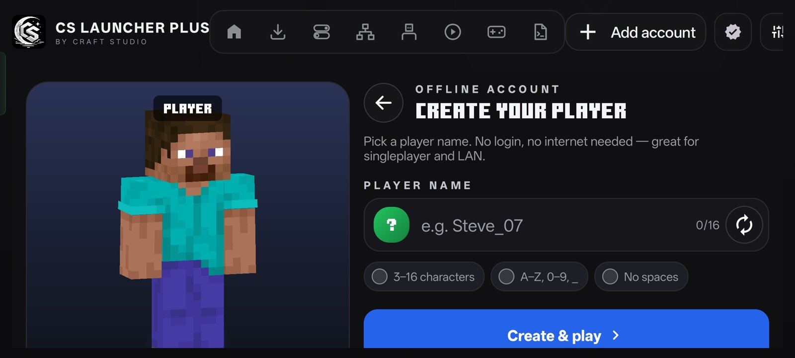
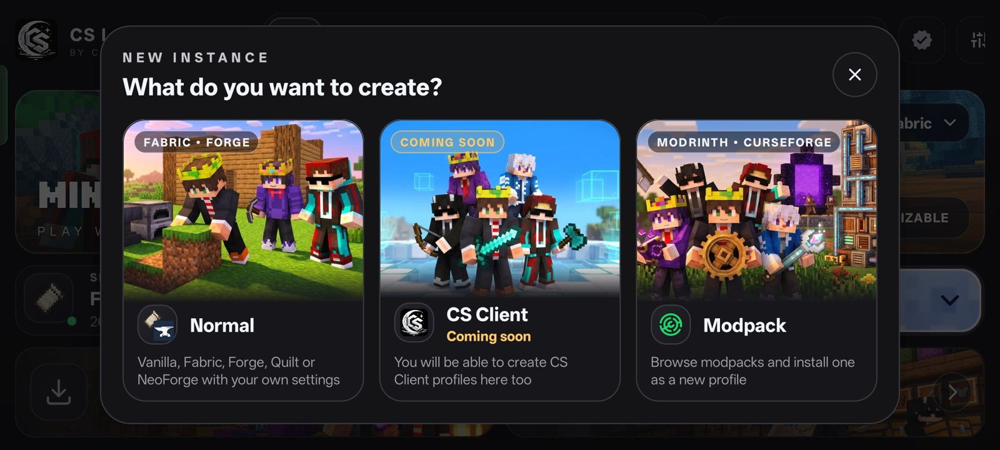
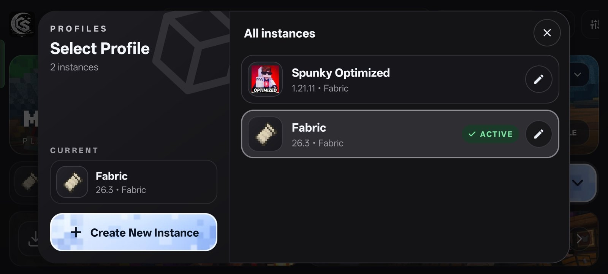
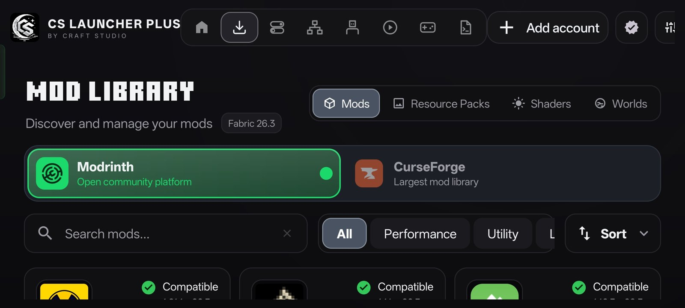
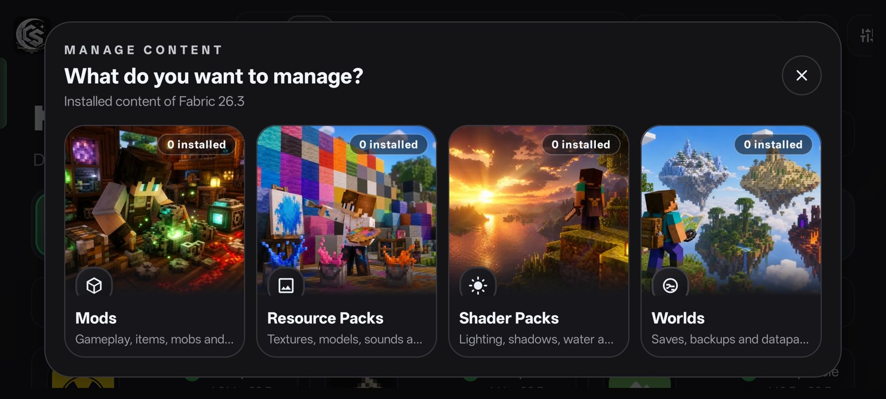
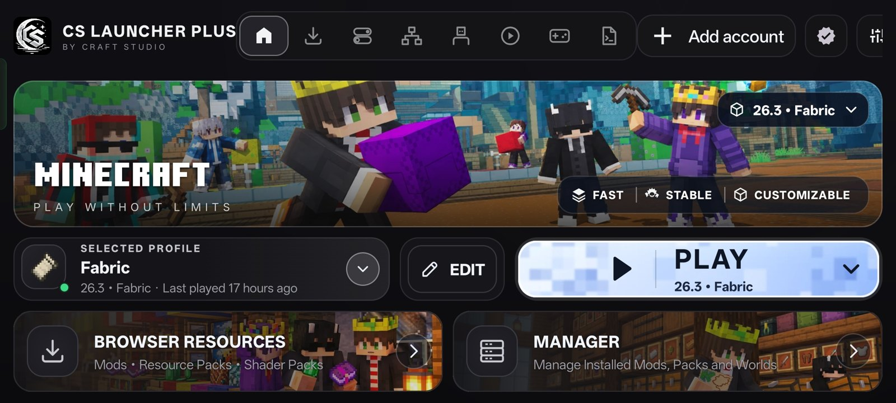

# CS Launcher Plus

**A fast, modern Minecraft: Java Edition launcher for Android**
 
Faster. Smoother. More customisable.

 

&nbsp;

&nbsp;

&nbsp;

  

&nbsp;

&nbsp;

 

 

## About

CS Launcher Plus lets you play Minecraft: Java Edition on Android with a clean, redesigned interface, one-tap mod loaders, built-in mod and world downloads, and tools that fix crashes for you. It is built by **Craft Studio** on top of the open-source PojavLauncher project.

 

## Highlights

| | Feature | What you get |
|:--|:--|:--|
|  | **Completely new UI** | Every screen rebuilt on one design system, smooth animations, light and dark theme |
|  | **Virtual LAN** Beta | Play Open-to-LAN worlds with friends over the internet, no port forwarding |
|  | **One-tap loaders** | Fabric, Forge, NeoForge, Quilt, OptiFine, Legacy Fabric and BTA, any loader version |
|  | **Modrinth + CurseForge** | Mods, resource packs, shaders and worlds, in the launcher and in-game |
|  | **Crash Auto Fix** | Reads the crash log, finds the cause and repairs it with one tap |
|  | **Custom storage folder** | Keep your game data wherever you want, with a built-in migration tool |
|  | **Control customisation** | Move, resize and re-skin every on-screen button |
|  | **Discord Rich Presence** | Shows the profile, version and server you are playing |

 

## Screenshots

<table>
<tr>
<td width="50%"> <b>Create instance</b> — Normal, CS Client or Modpack</td>
<td width="50%"> <b>Profiles</b> — switch, edit and create instances</td>
</tr>
<tr>
<td> <b>Mod library</b> — Modrinth and CurseForge, compatibility checked</td>
<td> <b>Manager</b> — installed mods, packs, shaders and worlds</td>
</tr>
<tr>
<td> <b>Accounts</b> — offline player with 3D skin preview</td>
<td> <b>Home</b> — selected profile, one-tap PLAY, resources and manager</td>
</tr>
</table>

 

## Features

### Interface
- New **home screen** with banner, profile card, version chip and a PLAY button that downloads and launches in one tap
- **Top navigation dock** — Home · Downloads · Mods · Multiplayer · Controls · Logs · Play Time
- Redesigned **settings hub**, account creation, account picker and 3D skin preview
- Brand-new **Play Time** page with per-day statistics
- Simple first-launch tutorial and a contextual help button
- **Languages:** English, Hinglish, Hindi and 8+ more

### Profiles and versions
- Every profile can use the classic **Vanilla look** or the custom **CS look**
- Profile editor with phone and tablet layouts, icon picker, loader and version pickers with search
- Per-profile RAM, Java runtime, renderer and shared or separate game folder
- Home-screen **shortcuts** that start a profile directly

### Mods, packs and worlds
- Browse and install from **Modrinth and CurseForge** with dependency handling and exact version matching
- **In-game resource browser** — download packs and shaders without leaving the game
- **World downloader** and world management: view, rename, delete, backup and restore
- One **Manager** tab for installed mods, packs and worlds, with mod updates

### Multiplayer
- **Virtual LAN (Beta):** host creates a session, shares a short code, friends join in one tap
- Works on Wi-Fi and mobile data, direct or relay connection, automatic reconnect
- Live member list, connection status, kick, diagnostics and Send logs

### Stability
- **Advanced Crash Auto Fix:** 15 crash categories detected, common problems repaired automatically
- Crash screen with AUTO FIX · VIEW CRASH REPORT · VIEW DETAILS · RETRY LAUNCH
- Silent crashes explained with a post-mortem report

 

## Install

1. Download the latest **CS-Launcher-Plus-vX.Y.Z.apk** from [Releases](https://github.com/craftstudioteam/CS-LAUNCHER-PLUS/releases/latest)
2. Open the file and allow installation from this source if Android asks
3. Launch, sign in or create a local account, pick a version and press **PLAY**

> **Updating from v1.5.0 or older?** v1.5.1 and newer use a new app signature, so they install as a separate app the first time. Install once and move your profiles over; every later update installs on top.

**Requirements:** Android 5.0+ (64-bit recommended), about 1 GB free storage, 3 GB RAM or more for modded play.

 

## Releases

| Version | Notes |
|:--|:--|
| [v1.5.1](https://github.com/craftstudioteam/CS-LAUNCHER-PLUS/releases/tag/v1.5.1) | Hotfix: "App not installed" error, Loader Version picker now lists every loader version |
| [v1.5.0](https://github.com/craftstudioteam/CS-LAUNCHER-PLUS/releases/tag/v1.5.0) | The Big Update: new UI, Virtual LAN, CurseForge, Crash Auto Fix, custom storage and more |

Full changelogs are on the [Releases](https://github.com/craftstudioteam/CS-LAUNCHER-PLUS/releases) page.

 

## Support and community

- **Discord:** https://discord.gg/dmteYqZZyY — help, announcements and feedback
- **YouTube:** https://youtube.com/@craft-studio-official — tutorials and update videos
- **Bugs:** open an [issue](https://github.com/craftstudioteam/CS-LAUNCHER-PLUS/issues) and attach the crash report from the crash screen or the Logs tab

If the game crashes after an update, open the crash screen and press **AUTO FIX** first. It solves most cases automatically.

 

## Partners

CS Launcher Plus is the official launcher of **OPTL (Official Pojav Tierlist)**. See the **Partners** page inside the launcher for details and perks.

 

## Credits and license

Built on [PojavLauncher](https://github.com/PojavLauncherTeam/PojavLauncher) and its open-source components (LWJGL, GL4ES, Mobile GLues and others). Minecraft is a trademark of Mojang Studios; this project is not affiliated with Mojang or Microsoft.

Licensed under the **GNU LGPL v3.0** — see [LICENSE](LICENSE). Read our [Privacy Policy](PRIVACY_POLICY_en).

 

Made with care by <b>Craft Studio</b>

